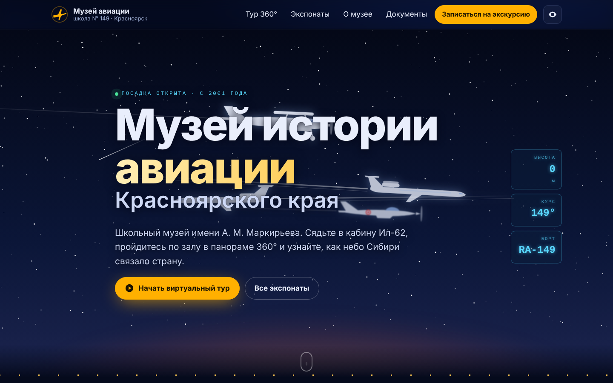

# Виртуальный музей истории авиации Красноярского края — школа № 149

Сайт школьного музея: панорамный тур 360°, каталог экспонатов, запись на экскурсию и кабинет
администратора. Стек: **Python 3.11+ / Django 5.2**, без фронтенд-сборки и без зарубежных CDN.



## Что внутри

| Раздел | Что делает |
|---|---|
| **Главная** | Ночное небо с эскадрильей самолётов музея (Ил-62, Ту-154, Ан-2, Р-39), табло вылетов с разделами, приборная панель Ил-62, экспонаты в виде посадочных талонов, летопись |
| **Тур 360°** (`/tour/`) | Панорамы на Pannellum: переходы между залами, точки-экспонаты с карточкой |
| **Экспонаты** (`/exhibits/`) | Поиск, фильтр по разделам, страница экспоната с галереей |
| **Люди трассы** (`/people/`) | Лётчики и техники трассы АлСиб: поиск, алфавит, карточка с портретом и боевым путём |
| **Запись на экскурсию** (`/visit/`) | Форма с отдельным согласием на обработку ПДн, защита от ботов, уведомление в MAX и на почту |
| **Кабинет** (`/cabinet/`) | Админка Django на русском: экспонаты с превью, панорамы с точками, заявки, документы |
| **Доступность** | Версия для слабовидящих (ГОСТ Р 52872-2019), клавиатурная навигация, `prefers-reduced-motion` |

## Быстрый старт

```bash
python -m venv .venv && source .venv/bin/activate
pip install -r requirements.txt
python manage.py migrate
python manage.py seed_demo          # демо-разделы, экспонаты, люди и 2 тестовые панорамы
python manage.py createsuperuser
python manage.py runserver
```

Сайт: http://127.0.0.1:8000, кабинет: http://127.0.0.1:8000/cabinet/

Тесты: `python manage.py test museum`

## Как администратору добавить экспонат

1. Кабинет → **Экспонаты** → «Добавить».
2. Название, раздел, фото и описание. Адрес страницы заполнится сам.
3. «Показывать на главной» — экспонат попадёт в блок «Избранное».
4. «Летает в небе на главной» — выберите силуэт, и самолёт будет пролетать над первым экраном со ссылкой на экспонат.
5. Если на фото или в тексте есть конкретные люди, отметьте «Согласие на публикацию ПДн получено» (только когда оно действительно есть).

## Как добавить панораму 360°

1. Снимите сферическую панораму: камерой 360° (Insta360, Ricoh Theta) или телефоном (Google Камера → «Фотосфера»).
   Нужен JPG в **эквидистантной проекции, 2:1** (например, 8000×4000), до ~15 МБ.
2. Кабинет → **Панорамы 360°** → «Добавить» → загрузите файл и отметьте стартовую точку.
3. Нажмите «Открыть режим разметки» и кликните по месту в панораме: появятся координаты `pitch / yaw`.
4. Внизу карточки панорамы добавьте точки: переход в другой зал или экспонат.

## Материалы с Google Диска

`python manage.py import_drive путь/к/папке --dry-run` — посмотреть, затем без `--dry-run` — импортировать.
Биографии (.docx), портреты и PDF распознаются сами; всё появляется скрытым до проверки. Подробно — DEPLOY.md, п. 6.

## Сервер и автодеплой

Beget VPS, установка одной командой, автодеплой по пушу в `main` с автоматическим откатом —
**[DEPLOY.md](DEPLOY.md)**. Работа в PyCharm — **[docs/PYCHARM.md](docs/PYCHARM.md)**.

Юридический чек-лист: [docs/LEGAL.md](docs/LEGAL.md).
